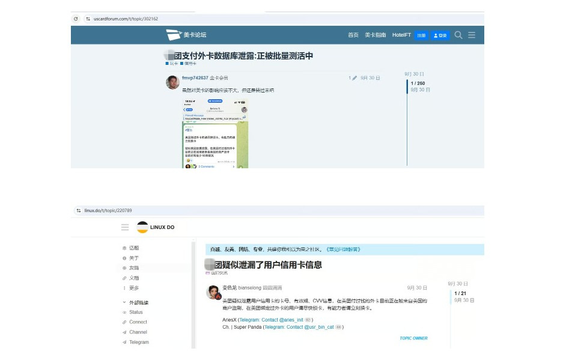
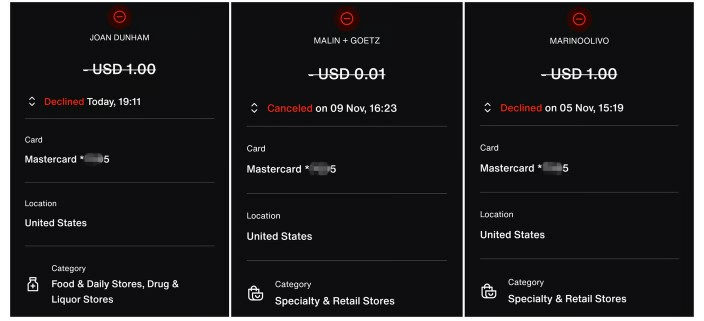

# 無需KYC的匿名虛擬信用卡｜USDT充值免實名萬事達Visa虛擬卡

## 什麼是無需KYC的匿名虛擬信用卡？

所謂 **「匿名虛擬信用卡」** 指的是線上建立萬事達、Visa卡時不需要KYC身分驗證，無需上傳任何個人身分證件即可開出的萬事達、Visa虛擬信用卡。這類虛擬卡僅需使用Email電子郵件註冊即可使用，全程無需提供身分證、護照等敏感個人資訊。

**匿名虛擬卡的核心特點**

- **無需KYC：** 不上傳任何身分證件，保護個人隱私
- **USDT充值：** 支援加密貨幣充值，進一步保護隱私
- **隨用隨充：** 用多少充多少，資金安全可控
- **即時開卡：** 線上即時開通，無需等待審核

## 為什麼你需要一張匿名萬事達Visa虛擬信用卡？

目前電信網路詐騙活動猖獗，我們在網路上註冊各種帳號時，不可避免地會將自己的電話、身分證、護照、銀行卡等敏感資訊上傳至網站平台。但由於一些網站平台本身存在安全漏洞，可能遭不法分子入侵並取得使用者隱私資訊，或由網站平台內部員工非法出售給黑灰產團隊，導致使用者經常受到電信詐騙電話或廣告騷擾，甚至造成經濟損失。

而一張可以在國際網路暢行無阻地付款，且**不需要實名身分認證的匿名虛擬信用卡**，便成了網路訂閱付款場景的剛性需求。即使信用卡號資訊遭竊，詐騙及黑灰產人員也無法取得使用者的真實資訊。

## 保護資金安全：隨用隨充的安心模式

除了保護隱私安全外，匿名虛擬卡也可以保障大家的資金安全。在一些不太可靠的海外電商平台下單時，通常需要輸入信用卡號碼、有效期限、CVV安全碼等資訊；黑客竊取這些資訊後，卡片內的資金就極易遭到盜用。

以某大型團購網站資料庫外洩事件為例，若平時使用綁定萬事達卡的方式在該網站訂購外送，資料庫外洩事件發生後，萬事達卡帳單中可能莫名出現一些1至3美元的小額付款失敗紀錄。這顯然是黑客取得卡號資訊後進行的「測活」；一旦小額測試付款成功，黑客便可能開始大額盜刷。

## 福田虛擬信用卡：無需KYC實名認證的匿名虛擬卡平台

針對上述使用者個人資訊隱私保護及信用卡資金安全問題，一款無需KYC實名認證、隨用隨充的即時虛擬信用卡便成了剛性需求。**[福田虛擬信用卡](https://dashboard.fotoncard.com/#/pages/register?agent=388832)** 就是這樣一個匿名虛擬信用卡平台。福田匿名虛擬卡優勢：

- **無需KYC：** 僅需使用Email電子郵件註冊，無需上傳任何身分證件
- **隨用隨充：** 需要多少就往卡片內充值多少
- **USDT充值：** 支援目前流行的USDT加密貨幣充值，保護隱私
- **安全保障：** 即使卡片遭竊，損失也僅限於卡內有限的金額
- **萬事達Visa：** 支援全球線上付款，暢行國際網路

退一步來說，即使卡片遭竊，損失也僅限於卡內有限的金額，總比存有大量資金的實體銀行卡或信用卡遭盜刷來得安心吧！福田卡支援目前流行的USDT加密貨幣充值，相較於傳統法幣充值，除了更加方便，也是保護個人隱私的有效方式。
